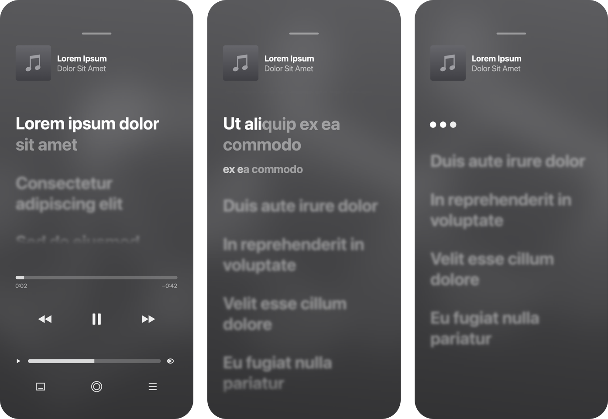
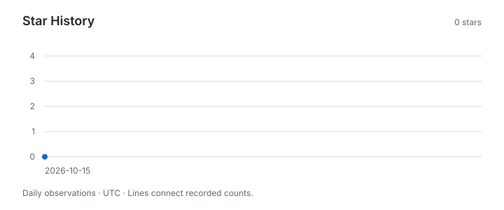

# iLyrics

[](https://github.com/x96x64/ilyrics/actions/workflows/ci.yml)
[](LICENSE)
[](#requirements)
[](https://www.swift.org)
[](https://developer.apple.com/documentation/coreml)
[](https://developer.apple.com/documentation/avfoundation)
[](https://developer.apple.com/documentation/coretext)
[](https://developer.apple.com/documentation/coreimage)
[](https://developer.apple.com/metal/)
[](https://developer.apple.com/documentation/accelerate)
[](https://github.com/facebookresearch/demucs)
[](https://huggingface.co/facebook/wav2vec2-base-960h)
[](scripts)

iLyrics renders lyrics videos that reproduce the Lyrics screen of the Music app on iPhone, and synchronizes plain lyrics to a recording automatically. It runs entirely on your Mac: vocal separation and speech recognition run through Core ML, frames are drawn with Core Text and Core Graphics, and no network service is involved after the one-time model installation.

```bash
ilyrics render song.m4a lyrics.txt -o video.mp4
```

<p align="center">
  
</p>

> [!IMPORTANT]
> Automatic synchronization supports English and may require manual correction. Japanese synchronization with `--language ja` is experimental. Backing choruses remain experimental and unsupported.
>
> All pooled third-qualification criteria for English synchronization were met on 80 unseen recordings, but three recordings failed the per-recording placement threshold of 80%; the complete locked qualification criteria were not met ([results](docs/reports/third-preview-qualification-results.md)). The visual preset was measured against unseen screen recordings of the Music app; the remaining weaknesses and known differences are listed under [Limitations](#limitations). See [Support](SUPPORT.md) for what is covered. iLyrics is not affiliated with, endorsed by, or sponsored by Apple.

## Contents

- [Features](#features)
- [Requirements](#requirements)
- [Installation](#installation)
- [Quick Start](#quick-start)
- [Usage](#usage)
- [Lyrics Input](#lyrics-input)
- [Reviewing an Alignment](#reviewing-an-alignment)
- [How It Works](#how-it-works)
- [Performance](#performance)
- [Troubleshooting](#troubleshooting)
- [SF Symbols and Rights](#sf-symbols-and-rights)
- [Limitations](#limitations)
- [Documentation](#documentation)
- [Contributing](#contributing)
- [Star History](#star-history)
- [Acknowledgments](#acknowledgments)
- [License](#license)

## Features

- **Automatic synchronization.** Plain text lyrics are aligned line by line and word by word against a separated vocal stem. Lines without reliable timing are placed rather than aligned, and are reported ([Reviewing an Alignment](#reviewing-an-alignment)).
- **A faithful Lyrics screen.** Focus motion, word fill with a gentle lift, emphasis of sustained final words, instrumental-gap indicators, a scrolling title, an artwork-derived background, and controls that hide after playback starts. These visual features are based on reference recordings of the Music app on iPhone running iOS 27, with the limitations stated below. Backing-chorus functionality remains implemented but is experimental, unverified, and unsupported.
- **Deterministic output.** Every frame is a pure function of its timestamp, so any frame can be rendered independently and in parallel. The default CPU inference reproduces the same alignment under the same input, model, and execution conditions. Encoded MP4 byte equality is not required, and raw raster comparisons must account for the operating system and rendering environment; `--fast` opts out of reproducible inference.
- **Supplied timing.** The supported TTML, LRC, and Enhanced-LRC subsets are rendered without automatic realignment; see [Lyrics Input Formats](docs/input-formats.md).
- **Local and private.** Recordings, lyrics, and videos never leave your Mac; the only network access is the model download.

## Requirements

- macOS 14 or later on Apple silicon
- For Homebrew and source builds, a Swift 6 toolchain: Xcode 16 or the Command Line Tools 16 or later
- About 600 MB of disk space for the alignment models, and 8 GB of memory or more for complete songs

## Installation

The npm and pip packages contain a prebuilt binary for Apple silicon and need no Swift toolchain; Homebrew builds the tagged source on your Mac. Install through one channel only, so that updating it updates the `ilyrics` you run.

### Homebrew

```bash
brew install x96x64/tap/ilyrics
```

### npm

```bash
npm install -g ilyrics
```

### pip

```bash
pipx install ilyrics    # or: pip install ilyrics
```

### From Source

```bash
git clone https://github.com/x96x64/ilyrics.git
cd ilyrics
swift build -c release
sudo install -m 755 .build/release/ilyrics /usr/local/bin/ilyrics
sudo mkdir -p /usr/local/share/ilyrics
sudo cp -R share/ilyrics/templates /usr/local/share/ilyrics/
```

The `mkdir` command creates the shared data directory, and the `cp -R` command installs the weightless model templates there. Running `.build/release/ilyrics` directly from the checkout needs no installation step.

### Alignment Models

The first `render` or `align` of plain text installs the alignment models automatically. To install them in advance:

```bash
ilyrics models install
```

Installation downloads about 460 MB from the publishers: the [HTDemucs](https://github.com/facebookresearch/demucs) checkpoint from Meta and the [wav2vec 2.0](https://huggingface.co/facebook/wav2vec2-base-960h) weights from Hugging Face. iLyrics verifies each file against a pinned SHA-256 digest, rebuilds the Core ML models on your Mac from weightless templates in this repository, runs a self-test, and deletes the downloads. The installed models occupy about 590 MB in `~/Library/Application Support/iLyrics/Models`. iLyrics does not redistribute either set of weights.

The first alignment of Japanese plain lyrics with `--language ja` installs a Japanese recognition model in the same way: about 1.3 GB of [ReazonSpeech wav2vec 2.0](https://huggingface.co/reazon-research/japanese-wav2vec2-large-rs35kh) weights from Hugging Face, which occupy about 1.2 GB once rebuilt.

```bash
ilyrics models status   # show the cache location and state
ilyrics models remove   # delete the installed models
```

### Updating

Only the latest release receives fixes. `ilyrics doctor` shows the installed version, where it was installed from, and the command that updates it.

| Channel | Update |
| --- | --- |
| Homebrew | `brew update && brew upgrade ilyrics` |
| npm | `npm install -g ilyrics@latest` |
| pip | `pipx upgrade ilyrics`, or `pip install --upgrade ilyrics` |
| Source | `git pull`, then repeat the build and installation steps |

The installed models remain valid across updates unless the [changelog](CHANGELOG.md) states otherwise.

### Uninstalling

Remove the models first, because they are stored outside the package, then uninstall through the channel you used:

```bash
ilyrics models remove
brew uninstall ilyrics       # or: npm uninstall -g ilyrics, pipx uninstall ilyrics, pip uninstall ilyrics
```

## Quick Start

Prepare an unprotected recording and a UTF-8 `lyrics.txt` containing the matching lead lyrics in sung order, one line per line, in English or, with `--language ja`, in Japanese. Replace the example paths below with your files. For a reproducible rendering check without a recording of your own, use the [supplied-timing example](docs/rendering-example.md); its generated tones do not test automatic synchronization.

```bash
# 1. Check the environment
ilyrics doctor

# 2. Render a video from a recording and plain lyrics
ilyrics render song.m4a lyrics.txt -o video.mp4
```

iLyrics reports its progress on standard error, one line per stage. In a terminal, the active stage is redrawn in place, with a bar and a percentage where the amount of work is known:

```text
==> [1/4] Reading audio                                              done
==> [2/4] Separating vocals   ##########################-----------  68.0%
```

When the command finishes:

```text
==> [1/4] Reading audio                                              done
==> [2/4] Separating vocals                                          done
==> [3/4] Aligning lyrics                                            done
==> [4/4] Rendering video                                            done
==> Generated video.mp4 in 5 minutes 9 seconds
```

In files, pipes, and CI logs, each finished stage is one plain line without a bar. Lyrics with supplied timing show the separation and alignment stages as `skip`. The finished video is a 1080 × 1920 H.264 file at 60 frames per second with AAC audio, ready for phones and social platforms.

## Usage

```
ilyrics render AUDIO LYRICS -o VIDEO.mp4 [options]
ilyrics align  AUDIO LYRICS -o LYRICS.ttml [options]
ilyrics models install | status | remove
ilyrics doctor
```

`render` produces a video. Plain text lyrics (`.txt`) are aligned first; timed lyrics (`.ttml`, `.lrc`) are used as supplied. `align` stops after synchronization and writes word-timed TTML, which you can inspect, correct, and render later. The title, artist, and artwork are read from the audio file's metadata; `--title`, `--artist`, and `--artwork` override them, and a placeholder is drawn when no artwork is available.

| Option | Commands | Meaning | Default |
| --- | --- | --- | --- |
| `-o, --output FILE` | render, align | Output file | Required |
| `--force` | render, align | Replace an existing output | Off |
| `--title TEXT`, `--artist TEXT` | render | Header text | From the audio file |
| `--credits TEXT` | render | Songwriters shown after the last line | A `Written by:` line in the lyrics |
| `--artwork FILE` | render | Artwork image | Embedded artwork |
| `--background artwork\|static` | render | Artwork-derived or static background | `artwork` |
| `--controls auto-hide\|visible` | render | Lower controls | `auto-hide` |
| `--safe-area none\|reels` | render | Keep controls and lyrics clear of the sides that Instagram Reels crops | `none` |
| `--no-marquee` | render | Keep an overflowing title static | Scrolling |
| `--no-gaps` | render | Omit instrumental-gap indicators | Shown |
| `--keep-ad-libs` | render, align | Keep vocable-only lines that cannot be timed | Omitted |
| `--language en\|ja` | render, align | Language of plain lyrics; `ja` is experimental | `en` |
| `-j, --jobs N` | render | Parallel rendering workers | Processor count |
| `--fast` | render, align | GPU and Neural Engine inference | CPU |
| `--report FILE` | render, align | JSON report of alignment and export | None |
| `-q, --quiet`, `-v, --verbose` | render, align, models | Only warnings and errors, or additional details | Progress and notes |

Exit status is 0 on success, 1 on a runtime failure, and 2 on a usage error. See [Command-Line Interface](docs/command-line-interface.md) for the complete reference and environment variables.

### Examples

```bash
# Align only, then review the report before rendering
ilyrics align song.m4a lyrics.txt -o lyrics.ttml --report report.json
ilyrics render song.m4a lyrics.ttml -o video.mp4

# Supply header text and artwork explicitly
ilyrics render song.wav lyrics.txt -o video.mp4 --title "Song Title" --artist "Artist Name" --artwork cover.jpg

# Keep the controls on screen and use a static background
ilyrics render song.m4a lyrics.ttml -o video.mp4 --controls visible --background static

# Keep the layout inside the width that Instagram Reels shows
ilyrics render song.m4a lyrics.ttml -o video.mp4 --safe-area reels

# Faster alignment on the GPU and Neural Engine, at the cost of reproducibility
ilyrics render song.m4a lyrics.txt -o video.mp4 --fast
```

## Lyrics Input

### Plain Text

Plain lyrics are UTF-8 text with one sung line per line and blank lines between sections, as they appear in most lyrics sources.

The following is an original non-chorus example:

```text
[Verse 1]
A compass rests beside the window
Morning gathers on the road

[Bridge]
Footsteps cross the empty station
Daylight reaches every stone
```

- Section labels in brackets, such as `[Chorus]`, are ignored.
- Do not include backing choruses in `lyrics.txt`, either as parenthesized phrases or as standalone chorus-only lines, even when written as ordinary lines. This functionality is experimental, unverified, and unsupported. Existing parenthesized input remains accepted: phrases are interpreted as backing vocals beneath their associated lead, and a parentheses-only line attaches to the preceding line. Interpretation and export are unchanged; this is a support restriction, not removal of input syntax.
- Lines containing neither letters nor digits, such as `...`, are ignored. Supported numeric lines such as `1, 2, 3, 4` are retained.
- Numbers are aligned as they are usually sung and displayed as written: 40 (forty), 1,000 (one thousand), 1999 (nineteen ninety-nine), 2005 (two thousand five), 3:00 (three o'clock), 3:15 (three fifteen), 21st (twenty-first), and '90s (nineties). Write a number in words if it is sung differently. Other forms, such as 3.5, are reported with their line and character.
- In a duet, a line beginning with `>` belongs to the second singer and is right-aligned, as the Music app shows it. TTML lyrics mark such paragraphs with `ttm:agent="v2"`.
- A line beginning with `Written by:` lists the songwriters. It is not sung; it is shown as "Written By: …" below the last line, as the Music app does.
- Sections longer than four lines are split into balanced groups; a six-line verse becomes two groups of three.
- Vocable-only lines, such as "ooh" or "na-na", remain usable. They may be omitted when reliable timing is unavailable. `--keep-ad-libs` retains them without guaranteeing accurate timing.

The lyrics must match the lead singer's sung sequence, in order. Ordinary lead-sung refrains remain permitted and should be repeated in full when sung again. A `[Chorus]` section label is also permitted and is ignored; neither a lead-sung refrain nor that label is a prohibited backing chorus.

See [Backing Choruses and Vocables](SUPPORT.md#backing-choruses-and-vocables) for the observed issues, warning behavior, and the limited vocable evaluation. These restrictions do not remove the existing input syntax or change its interpretation and export.

### Timed Lyrics

| Format | Extension | Timing |
| --- | --- | --- |
| TTML | `.ttml` | Line and word spans, including `ttm:role="x-bg"` background vocals |
| Enhanced LRC | `.lrc` with `<mm:ss.xx>` word tags | Line and word |
| LRC | `.lrc` | Line |

Accepted timed lyrics are rendered without automatic realignment. Word timing produces word-by-word fill; line timing fills each line steadily. The importers accept bounded subsets, not every TTML or Enhanced-LRC dialect; see [Lyrics Input Formats](docs/input-formats.md) for valid examples, required attributes, and size and timing limits.

### Audio

Any unprotected audio file that AVFoundation can decode is accepted, including AAC, MP3, WAV, AIFF, and Apple Lossless, also at high resolution such as 176.4 or 192 kHz (8 to 384 kHz). Recordings must be mono or stereo, at most twenty minutes long, and at most 2 GiB. The video's sound is AAC at 48 kHz, 256 kbps for stereo and 128 kbps for mono, converted once from the source; stereo sources keep stereo audio.

## Reviewing an Alignment

Automatic synchronization is reliable for most lines, but not all. iLyrics never invents word timing it cannot support:

- **Aligned** lines have accepted timing derived from the vocal stem. Low-confidence accepted lines can still use a steady line-level fill instead of word-by-word fill.
- **Placed** lines lack accepted acoustic timing and receive fallback intervals; they fill steadily rather than word by word. Interior unresolved runs retain their existing neighbour-based fallback.
- **Omitted** lines are untimed vocable-only lines, unless `--keep-ad-libs` is given.

Placed lines between two aligned lines are spread between them. A run of placed lines at the start or end of a song moves into the nearest stretch of vocal activity beside its aligned neighbour if it fits there completely, and otherwise stays next to that neighbour; no farther stretch is searched. Vocal activity is only a hint: it does not show that those words were sung, and a moved line remains placed rather than aligned ([Plan C](docs/reports/fallback-placement-plan-c.md)).

A `Note:` line states how many lines have no word timing or were omitted, `--verbose` lists them, and `--report FILE` writes every line's status, interval, word intervals, and reasons as JSON. To correct a result, edit the TTML written by `align` and render it as supplied timing. [Reviewing and Correcting an Alignment](docs/reviewing-alignment.md) explains report fields and units, how to locate a fallback line, and how to change paragraph and word timing.

## How It Works

1. **Decoding.** AVFoundation decodes the recording and resamples it at mastering quality.
2. **Vocal separation.** HTDemucs isolates the vocals. The network runs through Core ML; the spectrogram, its inverse, and resampling are implemented with Accelerate.
3. **Recognition.** wav2vec 2.0 produces character probabilities for every 20 ms of the vocal stem.
4. **Forced alignment.** A complete-sequence CTC alignment places every character of the lyrics, and words and lines are derived from it. Vocal-activity rules refine line boundaries and reject implausible results.
5. **Rendering.** The aligned lyrics are evaluated at exact rational timestamps into immutable screen snapshots, drawn with Core Text and Core Graphics, and encoded by parallel workers with AVFoundation.

The native pipeline reproduces the original Python research implementation exactly on a complete recording. The design and its measurements are recorded in [Native Alignment Pipeline](docs/reports/native-alignment-pipeline.md).

## Performance

Measured with iLyrics 1.1.0 on an Apple M4 (10 cores, 16 GB) with a 4 min 54 s recording decoded from 176.4-kHz Apple Lossless:

| Step | Time |
| --- | ---: |
| Decoding | 6 s |
| Vocal separation | 39 s |
| Recognition and alignment | 11 s |
| Rendering and encoding (17,629 frames) | 5 min 59 s |
| **Complete `render` of plain lyrics** | **6 min 58 s** |

Peak memory was 2.3 GB for the complete `render`. Rendering scales with processor cores; use `--jobs` to limit it. `--fast` shortens separation and recognition but may change results slightly between runs.

## Troubleshooting

Run `ilyrics doctor` first; it shows the installed version and checks each requirement, with the recovery step for any problem. If a message or behavior differs from this README, update to the latest release first.

| Message | Remedy |
| --- | --- |
| `model templates were not found` | Run iLyrics from the cloned repository or an installed package, or set `ILYRICS_TEMPLATES`. |
| `model download failed` | Check the network connection and run `ilyrics models install` again; verified downloads are reused. |
| `line N of FILE contains "…"` | Write the number or symbol as it is sung, or remove it. For Japanese lyrics, add `--language ja`. |
| `FILE is empty`, `contains no lines to sing` | Add the lyrics, one sung line per line; section labels and `Written by:` lines are not lyrics. |
| `the lyrics cannot be aligned` | Read the specific reason after the message and check the [input limits](docs/input-formats.md#limits-and-timing-validation). Shorten an overlong line or reduce an oversized input; adding section breaks does not reduce a whole-song limit. |
| `Audio has N channels` | Mix the recording down to stereo. |
| `Protected audio is unsupported` | Use a file you own without DRM; streamed Apple Music downloads cannot be read. |
| `... already exists` | Choose another output or pass `--force`. |
| `... is a folder`, `is also given as` | Name a new output file; iLyrics never writes over a folder or one of its inputs. |
| `the folder for ... does not exist` | Create the folder or correct the output path. |
| `wraps to more than eight rows on screen` | Split the long line into shorter lines, or the paragraph into separate paragraphs. |
| `is shorter than one second`, `is silent` | Use the complete recording with audible vocals. |

## SF Symbols and Rights

Control icons are SF Symbols, resolved at render time from the Mac running iLyrics; iLyrics never bundles or redistributes them. Apple's [SF Symbols license](https://developer.apple.com/support/terms/) does not expressly permit their use in exported videos, so you are responsible for how you use and publish the videos you create. The demonstration image above shows SF Symbols rendered the same way; the original icon set in this repository is used for tests. See [SF Symbols Rights Assessment](docs/sf-symbols-rights-assessment.md).

The demonstration uses "The Star" by Jane Taylor (1806), which is in the public domain, with synthetic timing and no recording.

You are likewise responsible for holding the rights to the recordings, lyrics, and artwork you render. iLyrics does not download lyrics or audio.

## Limitations

- Automatic synchronization supports English. Japanese synchronization with `--language ja` is experimental: lines that begin with English words may start late, line changes may come slightly early or late, and every forced alignment is accepted without the acoustic checks applied to English, so review the result before publishing. It was evaluated on one album only ([report](docs/reports/japanese-alignment.md)). Japanese typography and line wrapping have not been compared with the native screen. Other languages are not supported.
- Backing choruses, including parenthesized phrases and standalone chorus-only lines written as ordinary lines, are experimental, unverified, and unsupported. Exclude them from `lyrics.txt`; lead-sung refrains, `[Chorus]` labels, and vocable-only lines remain permitted. See [Plain Text](#plain-text) for observed issues and unchanged compatibility.
- In the historical evaluation of commit `e0ab92a`, 95.9% of 3,005 scored lines across 80 unseen recordings had an accepted interval overlapping the manual reference interval, 0.5% had accepted intervals without overlap, and 3.6% were unresolved; three recordings fell below 80% ([qualification results](docs/reports/third-preview-qualification-results.md)). This is a line-placement measure, not word-timing accuracy or a fresh evaluation of v1.3.0. Unresolved lines may receive fallback timing in the exported video. Accuracy is lower when several singers sing different words at once and for shouted or heavily processed vocals. Lines without reliable timing are placed rather than aligned and fill steadily rather than word by word; see [Reviewing an Alignment](#reviewing-an-alignment).
- Rendering targets the iPhone portrait screen at 1080 × 1920 and 60 frames per second.
- The visual target is the Music app on iPhone 16 running iOS 27, in light appearance with the default text size. Against six unseen screen recordings, control positions and the auto-hide delay match within the approved thresholds; focus motion, word fill timing, title marquee timing, paragraph spacing, and most line wrapping are close; the known differences are the background's colour and contrast, inactive lines that are brighter than native, the timing of the instrumental-gap indicator, and some wrapped lines ([visual qualification results](docs/reports/visual-qualification-results.md)).
- Translations, the Sing mode, and landscape layouts are not rendered.

## Documentation

- [Command-Line Interface](docs/command-line-interface.md): commands, options, and environment variables
- [Lyrics Input Formats](docs/input-formats.md): current subsets, examples, and limits
- [Reviewing and Correcting an Alignment](docs/reviewing-alignment.md): report fields and manual timing correction
- [Rendering a Supplied-Timing Example](docs/rendering-example.md): a local check with generated audio
- [Roadmap to the Stable Release](docs/roadmap-to-stable.md): current status and the preserved release-stage record
- [Native Alignment Pipeline](docs/reports/native-alignment-pipeline.md) and [Native Model Installation and Decoding](docs/reports/native-model-installation.md)
- [Model Template Distribution](docs/reports/model-template-distribution.md): what the repository's model templates contain
- [Documentation Index](docs/README.md): every engineering report by topic, in chronological order

## Contributing

Issues and pull requests are welcome. Before submitting a change:

```bash
swift build
swift test
swift format lint --strict --recursive Sources Tests Package.swift
```

The public test suite uses only original synthetic fixtures and needs neither the network nor private recordings. Read [AGENTS.md](AGENTS.md) for the engineering constraints, including determinism, evidence classification, and the rules for private reference material. Code is formatted with the toolchain's `swift format` (`.swift-format`), which CI checks. Commits follow [Conventional Commits](https://www.conventionalcommits.org/).

## Star History

<picture>
  <source media="(prefers-color-scheme: dark)" srcset="docs/media/stars/dark.svg">
  
</picture>

Star counts are recorded daily in UTC, beginning on October 15, 2026. Lines connect recorded observations; dates before the first observation and missed observations are not reconstructed. The [recorded counts](docs/media/stars/history.json) include decreases when stars are removed.

## Acknowledgments

iLyrics was developed with [Codex](https://openai.com/codex) by OpenAI and [Claude](https://claude.ai) by Anthropic, credited as co-authors in the commit history. It builds on [Demucs](https://github.com/facebookresearch/demucs) by Meta AI Research (MIT License) and [wav2vec 2.0](https://huggingface.co/facebook/wav2vec2-base-960h) by Meta AI (Apache License 2.0).

## License

iLyrics is licensed under the [Apache License, Version 2.0](LICENSE). The alignment models are downloaded from their publishers under their own licenses.
